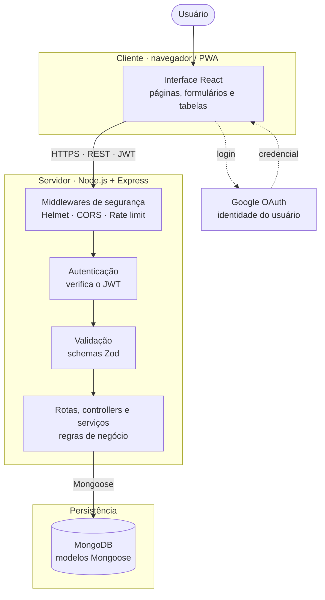
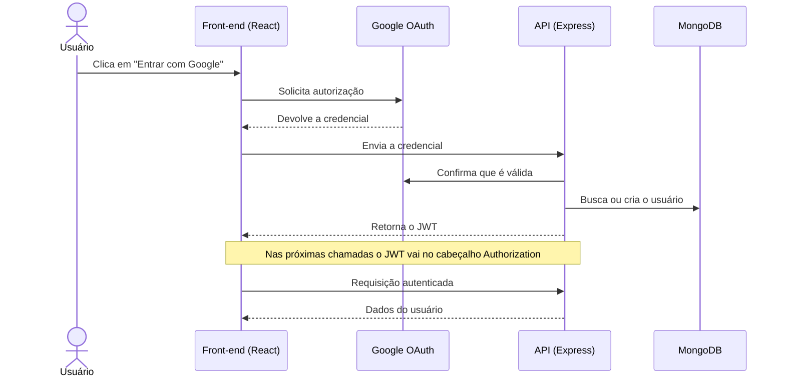
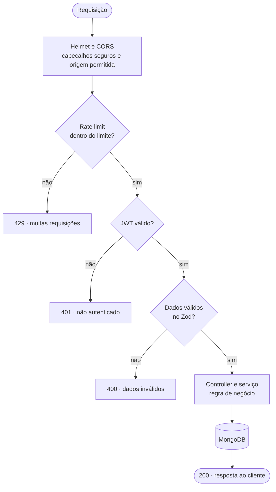

<div align="center">

# Caderno de Contas

**Aplicação full stack de controle financeiro: parcelas, extratos, importação de planilhas e visão por pessoa.**

[](https://sistema-financeiro-4ing.onrender.com/)


</div>

---

## Sobre

O projeto nasceu de uma planilha de controle financeiro e virou um sistema completo: o que antes dependia de abas, fórmulas e cópia manual agora tem login, regras de negócio, histórico e uma interface feita para o dia a dia.

## Demo

🔗 **https://sistema-financeiro-4ing.onrender.com/**

> O back-end está em hospedagem gratuita, então o primeiro acesso pode levar alguns segundos para "acordar". <!-- remova se não for o seu caso -->

## Screenshots

| Dashboard | Parcelas |
| :--: | :--: |
|  |  |
| **Importação** | **Perfil da pessoa** |
|  |  |

## Funcionalidades

- Login com **Google** e autenticação por **JWT**.
- Controle de parcelas de cartões e contas fixas (luz, água, etc.), com marcação de pagas e pendentes, inclusive em lote.
- Visão por pessoa: resumo, extrato, planilha e cobrança.
- Importação de planilhas e faturas.
- Interface responsiva e com instalação como app (PWA).

<!-- ajuste a lista ao que está realmente no ar -->

## Arquitetura

O sistema é dividido em três blocos independentes: **front-end**, **API** e **banco de dados**. O front-end nunca acessa o banco diretamente. Toda leitura e escrita passa pela API, que autentica, valida e só então persiste.

### Visão geral



### Fluxo de login



<!-- ajuste este fluxo se o login do seu projeto for feito de outra forma (por exemplo, fluxo por redirecionamento no servidor) -->

### Caminho de uma requisição na API

Toda chamada passa pelas mesmas barreiras, na mesma ordem. Se uma falha, a API responde na hora e o restante nem executa.



### Organização do back-end

O código é organizado em camadas, cada uma com uma responsabilidade:

| Camada | Responsabilidade |
| :-- | :-- |
| **Rotas** | Definem os endereços e encaminham para o controller certo |
| **Middlewares** | Segurança, autenticação, limite de requisições e tratamento de erros |
| **Schemas (Zod)** | Descrevem e validam o formato dos dados que entram |
| **Controllers** | Recebem a requisição e devolvem a resposta |
| **Serviços** | Concentram as regras de negócio, sem depender do Express |
| **Models (Mongoose)** | Definem as coleções e o acesso ao MongoDB |

```
backend/
├── src/
│   ├── routes/         # endereços da API
│   ├── controllers/    # entrada e saída das rotas
│   ├── services/       # regras de negócio
│   ├── models/         # modelos Mongoose
│   ├── schemas/        # validações Zod
│   ├── middlewares/    # auth, rate limit, erros
│   └── config/         # variáveis de ambiente e conexão
└── .env.example
```

<!-- ajuste os nomes das pastas à estrutura real do projeto -->

### Rotas principais

| Recurso | Base | O que faz |
| :-- | :-- | :-- |
| Autenticação | `/auth` | Login com Google e emissão do JWT |
| Pessoas | `/pessoas` | Cadastro e perfil de cada pessoa (resumo, extrato, planilha e cobrança) |
| Parcelas | `/parcelas` | Cartões e contas fixas, com marcação de paga ou pendente, inclusive em lote |
| Importação | `/importacao` | Entrada de planilhas e faturas |

<!-- substitua pelos endereços reais da sua API -->

### Decisões de projeto

| Decisão | Motivo |
| :-- | :-- |
| Front-end e back-end separados | Cada parte evolui, é testada e é hospedada de forma independente |
| JWT para sessão | A API não guarda sessão em memória, o que facilita escalar |
| Google OAuth | O usuário não cria nem guarda mais uma senha |
| Validação com Zod na borda | Dado inválido é barrado antes de chegar à regra de negócio e ao banco |
| Middlewares de segurança em todas as rotas | Proteção aplicada por padrão, sem depender de lembrar rota por rota |
| Regras de negócio em serviços | Dá para testar a lógica sem subir o servidor |

## Stack

| Área | Tecnologias |
| :-- | :-- |
| Front-end | React · JavaScript |
| Back-end | Node.js · Express |
| Banco de dados | MongoDB com Mongoose |
| Autenticação | JWT · Google OAuth |
| Validação | Zod |
| Hospedagem | Render |

## Segurança

| Medida | Como foi aplicada |
| :-- | :-- |
| Senhas | Armazenadas com hash (bcrypt) |
| Sessão | Tokens JWT |
| Entrada de dados | Validação com Zod em todas as rotas |
| Cabeçalhos HTTP | Helmet |
| Origens permitidas | CORS restrito |
| Abuso de requisições | Rate limiting |
| Segredos | Variáveis de ambiente, fora do repositório |

## Como rodar localmente

**Pré-requisitos:** Node.js 18+ e uma instância do MongoDB (local ou Atlas).

```bash
git clone https://github.com/biancamx/sistema-financeiro.git
cd sistema-financeiro
```

**Back-end**

```bash
cd backend            # ajuste ao nome real da pasta
npm install
cp .env.example .env
npm run dev
```

**Front-end**

```bash
cd frontend           # ajuste ao nome real da pasta
npm install
npm run dev
```

**Variáveis de ambiente** (`backend/.env`), ajuste aos nomes reais:

```env
PORT=3000
MONGODB_URI=
JWT_SECRET=
GOOGLE_CLIENT_ID=
GOOGLE_CLIENT_SECRET=
CLIENT_URL=http://localhost:5173
```

## Roadmap

- [ ] Migração para PostgreSQL com Prisma
- [ ] Containerização com Docker
- [ ] Testes automatizados (API e interface)
- [ ] Pipeline de CI/CD
- [ ] Relatórios e gráficos por período

## Autora

**Maria Bianca Moura** · [LinkedIn](https://www.linkedin.com/in/SEU-LINKEDIN/) · [GitHub](https://github.com/biancamx)
